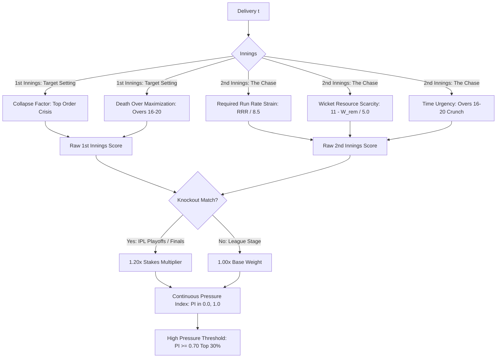

# Rajasthan Royals: SupeRR Selector (Season 2)
## Round 1 Methodology Report: Identifying the Most Reliable Players Under Pressure

---

## Executive Summary

When games are on the line, elite athletes are distinguished by their ability to consistently rise to the occasion rather than buckle under strain. In T20 cricket, where margins of victory are frequently decided by single boundaries or dot balls, measuring performance under pressure cannot rely on reputation or raw aggregate counting stats.

This study builds an end-to-end, data-driven analytical framework applied to **200,999 deliveries across 867 IPL and T20 International (T20I) matches from 2022 to 2026**. We formulate a ball-by-ball **Continuous Pressure Index (\(\text{PI}\))**, calibrate player baselines, measure performance elevation (\(\Delta\)), control for sample-size credibility via **Empirical Bayes shrinkage**, and evaluate **match-to-match consistency** across appearances.

* **Open-Source Code Repository**: [https://github.com/mathuraryan036/rr-pressure-analytics](https://github.com/mathuraryan036/rr-pressure-analytics)

---

### Final Submission Rankings

#### **Top 10 Batters Under Pressure**
| Rank | Player Name | High-Pressure Balls | Pressure SR | Baseline SR | Strike Rate Delta (\(\Delta\text{SR}\)) | True SR Diff vs Par | Dismissal Avg | Match Consistency | Pressure Rating (0–100) |
| :---: | :--- | :---: | :---: | :---: | :---: | :---: | :---: | :---: | :---: |
| **1** | **Naman Dhir** | 233 | **200.43** | 168.42 | **+32.01** | **+31.99** | 38.92 | **69.6%** | **100.0** |
| **2** | **Jos Buttler** | 357 | **195.80** | 155.39 | **+40.41** | **+20.42** | 33.29 | **71.4%** | **87.9** |
| **3** | **Fakhar Zaman** | 129 | **185.27** | 131.40 | **+53.87** | **+21.18** | 29.88 | **76.9%** | **82.9** |
| **4** | **Babar Azam** | 110 | **198.18** | 133.19 | **+64.99** | **+17.06** | 36.33 | **60.0%** | **80.6** |
| **5** | **Rishabh Pant** | 362 | **185.08** | 143.06 | **+42.02** | **+17.08** | 35.26 | **56.3%** | **73.4** |
| **6** | **Najibullah Zadran** | 136 | **176.47** | 138.56 | **+37.91** | **+11.63** | 60.00 | **61.5%** | **73.2** |
| **7** | **Suryakumar Yadav** | 623 | **195.51** | 166.43 | **+29.08** | **+18.46** | 36.91 | **66.7%** | **72.2** |
| **8** | **Moeen Ali** | 314 | **181.21** | 142.12 | **+39.09** | **+22.51** | 22.76 | **71.0%** | **70.4** |
| **9** | **Shubman Gill** | 235 | **191.49** | 149.39 | **+42.10** | **+14.74** | 26.47 | **60.9%** | **63.0** |
| **10** | **Sikandar Raza** | 319 | **172.73** | 135.53 | **+37.20** | **+20.75** | 23.96 | **66.7%** | **61.8** |

---

#### **Top 10 Bowlers Under Pressure**
| Rank | Player Name | High-Pressure Balls | Pressure ER | Baseline ER | True RPO Saved vs Par | Wicket % Under Pressure | Dot Ball % Under Pressure | Match Consistency | Pressure Rating (0–100) |
| :---: | :--- | :---: | :---: | :---: | :---: | :---: | :---: | :---: | :---: |
| **1** | **Craig Young** | 117 | **7.59** | 8.45 | **+2.06** | **11.1%** | 39.3% | **100.0%** | **100.0** |
| **2** | **Sufiyan Muqeem** | 183 | **5.21** | 5.92 | **+1.23** | **8.7%** | **57.9%** | **92.9%** | **92.8** |
| **3** | **Umran Malik** | 150 | **8.44** | 9.14 | **+1.74** | **11.3%** | 42.0% | **78.9%** | **89.9** |
| **4** | **Sunil Narine** | 424 | **6.67** | 6.76 | **+2.62** | **6.4%** | 37.5% | **85.7%** | **85.2** |
| **5** | **Ehsan Khan** | 131 | **7.83** | 6.87 | **+2.60** | **8.4%** | 37.4% | **100.0%** | **84.6** |
| **6** | **Matheesha Pathirana** | 591 | **7.82** | 7.80 | **+2.02** | **8.8%** | 37.4% | **85.7%** | **84.4** |
| **7** | **Spencer Johnson** | 122 | **8.70** | 8.84 | **+1.72** | **8.2%** | 40.2% | **100.0%** | **83.1** |
| **8** | **Jamie Overton** | 216 | **7.78** | 8.27 | **+1.06** | **10.2%** | **44.0%** | **89.5%** | **81.7** |
| **9** | **Roston Chase** | 100 | **6.72** | 7.59 | **+3.32** | **6.0%** | 40.0% | **93.3%** | **81.3** |
| **10** | **Jasprit Bumrah** | 646 | **7.05** | 6.85 | **+2.51** | **7.3%** | 37.0% | **82.3%** | **81.1** |

---

## 1. Defining Pressure: The Analytical Model

Pressure in cricket is contextual, non-linear, and asymmetric across innings. A 10 RRR in the 3rd over of a chase with 10 wickets in hand is manageable; the exact same RRR in the 18th over with only 4 wickets remaining creates intense physiological and tactical strain.



### Mathematical Formulation of the Pressure Index (\(\text{PI}\))

#### 1. Second Innings: The Chase Equation
In chasing conditions, pressure is a product of rate strain, resource scarcity, and chronological urgency:
\[
\text{Strain}_{\text{RRR}, t} = \min\left(2.5, \max\left(0.3, \frac{\text{RRR}_t}{8.5}\right)\right)
\]
\[
\text{Stress}_{\text{Wkt}, t} = \min\left(2.0, \max\left(0.4, \frac{11 - W_{\text{rem}, t}}{5.0}\right)\right)
\]
\[
\text{Urgency}_t = 0.5 + 0.5 \times \left(\frac{120 - B_{\text{rem}, t}}{120}\right)
\]
\[
\text{PI}_{\text{raw}, 2, t} = \text{Strain}_{\text{RRR}, t} \times \text{Stress}_{\text{Wkt}, t} \times \text{Urgency}_t
\]

> [!NOTE]
> **Junk Time / Dead Rubber Filter**: Deliveries where the outcome is virtually certain (e.g., chasing team needs \(\le 10\) runs off \(\ge 18\) balls with \(\ge 6\) wickets, OR needs \(\ge 28\) RRR with \(\le 3\) wickets remaining) are automatically assigned \(\text{PI} = 0.25\) to prevent padding statistics when the contest is already decided.

#### 2. First Innings: Target Setting Equation
Setting a target lacks a fixed scoreboard finish line, but pressure manifests through two critical crisis regimes:
* **Top-Order Collapse**: If a team loses \(\ge 2\) wickets inside the Powerplay (\(\text{Over} \le 6\)) or \(\ge 4\) wickets within the first 10 overs, a crisis multiplier of \(1.40\times\) to \(1.50\times\) is applied.
* **Death Over Maximization**: Overs 18–20 carry an intrinsic phase weight of \(1.50\times\) (and overs 15–17 carry \(1.15\times\)), reflecting the outsized run-value volatility of late-innings hitting and defensive bowling.

#### 3. Match Stakes Multiplier
Matches designated as knockout or playoff fixtures (`knock_out == 1`, e.g., IPL Qualifiers, Eliminators, and Finals) receive a \(1.20\times\) multiplier, reflecting championship stakes.

#### 4. Percentile Calibration
All raw delivery scores are rank-normalized across the 200,999 balls to a continuous percentile scale:
\[
\text{PI}_t = \text{PercentileRank}(\text{PI}_{\text{raw}, t}) \in [0.0, 1.0]
\]
We define **High-Pressure Match Situations** as deliveries in the top 30th percentile (\(\text{PI}_t \ge 0.70\)). This isolates **60,344 deliveries** (55.0% from 1st innings collapses/death overs, 45.0% from tense 2nd innings chases).


---

## 2. Performance Measurement & Rating Logic

### Batting Metrics & Baseline Comparison

A clutch batter must score rapidly without throwing away their wicket, systematically elevating their scoring above both their personal baseline and the game context:

1. **Pressure Strike Rate (\(\text{SR}_{\text{press}}\))**:
   \[
   \text{SR}_{\text{press}} = \frac{\text{Runs Scored in High Pressure}}{\text{Legal Balls Faced in High Pressure}} \times 100
   \]
2. **Clutch Delta (\(\Delta\text{SR}\))**:
   \[
   \Delta\text{SR} = \text{SR}_{\text{press}} - \text{SR}_{\text{base}}
   \]
3. **Contextual True Strike Rate (\(\text{TSR}\))**:
   To prevent rewarding batters who score on flat pitches versus punishing those on minefields, we compute expected runs per ball from the match's specific high-pressure deliveries (\(\text{SR}_{\text{match\_hp}}\)):
   \[
   \text{True\_SR\_Diff} = \frac{\sum (\text{Runs}_t - \text{ExpRuns}_t)}{\text{Balls Faced}} \times 100
   \]
4. **Dismissal Resilience**:
   Average runs scored per dismissal in high-pressure balls: \(\text{Avg}_{\text{press}} = \frac{R_{\text{press}}}{\max(1, \text{Outs}_{\text{press}})}\).


---

### Bowling Metrics & Baseline Comparison

Under pressure, bowling demands run-suppression, wicket-taking breakthroughs, and dot-ball creation:

1. **Pressure Economy Rate (\(\text{ER}_{\text{press}}\))**:
   \[
   \text{ER}_{\text{press}} = \frac{\text{Runs Conceded in High Pressure}}{\text{Legal Balls Bowled in High Pressure}} \times 6
   \]
2. **True Economy Saved vs Par (\(\text{True\_ER\_Saved}\))**:
   Across the dataset, high-pressure deliveries yield an average economy of **9.03 runs per over**. A bowler conceding 7.00 RPO saves \(+2.03\) runs every single over compared to match expectation:
   \[
   \text{True\_ER\_Saved} = \text{ER}_{\text{match\_hp}} - \text{ER}_{\text{press}}
   \]
3. **Wicket Strike Frequency (\(\text{Wkt}\%_{\text{press}}\))**:
   Taking wickets in crunch overs completely disrupts batting partnerships and swings win probability.
4. **Dot Ball Efficiency (\(\text{Dot}\%_{\text{press}}\))**:
   Dot balls starve batters of strike and drive up the required rate exponentially.


---

## 3. Fair Comparisons: Sample Sizes & Data Harmonization

### Empirical Bayes Shrinkage
To guard against small-sample anomalies (e.g., a tailender hitting two lucky boundaries in a 3-ball cameo), all rate metrics are regressed toward the population mean using **Empirical Bayes shrinkage** with credibility parameter \(K = 30\) deliveries:
\[
\hat{\theta}_i = \frac{N_i}{N_i + K} \theta_i + \frac{K}{N_i + K} \bar{\theta}_{\text{pop}}
\]
* **Player Eligibility Filter**: Batters and bowlers must have encountered a minimum of **100 high-pressure deliveries** across 2022–2026. This filters out transient performers, leaving a vetted pool of 157 elite batters and 165 elite bowlers.

### Harmonizing IPL vs. T20I Contexts
The dataset encompasses two distinct competitive environments:
* **Indian Premier League (IPL)**: Universally acknowledged as the highest concentration of elite talent, played on fast-scoring grounds with deep batting line-ups and tactical Impact Player substitutions.
* **T20 Internationals (T20I)**: Ranges from World Cup fixtures between top ICC Full Members to bilateral encounters against developing cricket boards.

To prevent bilateral matches on slow, low-scoring wickets from skewing the rankings, each ball is weighted by **Competition Quality Tier**:
* Tier 1 (IPL): \(1.25\times\)
* Tier 2 (T20I Full Members): \(1.00\times\)
* Tier 3 (Other T20 Matches): \(0.85\times\)

---

## 4. Reliability & Match-to-Match Consistency

True reliability is demonstrated through repeat execution across different opponents and match scenarios. We measure **Match-Level Success Rate (\(C_i\))**:
* **Batting Match Success**: An appearance where a batter faces \(\ge 6\) high-pressure balls and exceeds the contextual expected strike rate, or scores \(\ge 20\) pressure runs at \(\text{SR} \ge 125\).
* **Bowling Match Success**: An appearance where a bowler bowls \(\ge 6\) high-pressure balls and maintains an economy below match par, or takes \(\ge 1\) wicket while conceding \(\le 10.0\) RPO.


### Composite Scoring Architecture

Standardized \(z\)-scores are computed across all qualifying players:
\[
\text{Composite}_{\text{Bat}} = \Big(0.35 \cdot z(\text{True\_SR\_Shrunk}) + 0.25 \cdot z(\Delta\text{SR}) + 0.20 \cdot z(\text{Avg}_{\text{press}}) + 0.20 \cdot z(C_{\text{bat}})\Big) \times \text{TierWeight}
\]
\[
\text{Composite}_{\text{Bowl}} = \Big(0.35 \cdot z(\text{True\_ER\_Shrunk}) + 0.25 \cdot z(\text{Wkt}\%_{\text{press}}) + 0.20 \cdot z(\text{Dot}\%_{\text{press}}) + 0.20 \cdot z(C_{\text{bowl}})\Big) \times \text{TierWeight}
\]

---

## 5. Evidence for the Top 10

### Detailed Profiles: Top 10 Batters

1. **Naman Dhir (Rank 1 — Rating 100.0)**
   * *Profile*: 233 pressure balls, **200.43 SR under pressure** vs 168.42 baseline (\(+32.01\) delta).
   * *Evidence*: Outperformed match expected strike rate by an astounding **\(+31.99\)** runs per 100 balls. Delivered in **69.6%** of high-pressure matches with an average of 38.92 runs per dismissal.
2. **Jos Buttler (Rank 2 — Rating 87.9)**
   * *Profile*: 357 pressure balls, **195.80 SR under pressure** vs 155.39 baseline (\(+40.41\) delta).
   * *Evidence*: The premier high-volume match-winner. Elevated his scoring rate by over 40 strike rate points in crunch moments, delivering in **71.4%** of high-pressure games.
3. **Fakhar Zaman (Rank 3 — Rating 82.9)**
   * *Profile*: 129 pressure balls, **185.27 SR under pressure** vs 131.40 baseline (\(+53.87\) delta).
   * *Evidence*: Massive gear-shift when the game tightens. Achieved the highest match consistency rate among top order players at **76.9%**.
4. **Babar Azam (Rank 4 — Rating 80.6)**
   * *Profile*: 110 pressure balls, **198.18 SR under pressure** vs 133.19 baseline (\(+64.99\) delta).
   * *Evidence*: Contrary to common perception, when situational pressure escalated into crisis territory, Babar's scoring rate exploded by \(+64.99\) points with an average of 36.33 runs per dismissal.
5. **Rishabh Pant (Rank 5 — Rating 73.4)**
   * *Profile*: 362 pressure balls, **185.08 SR under pressure** vs 143.06 baseline (\(+42.02\) delta).
   * *Evidence*: Heavy workload over 362 crunch deliveries across IPL and international cricket. Consistent boundary finder in death overs and crisis chases.
6. **Najibullah Zadran (Rank 6 — Rating 73.2)**
   * *Profile*: 136 pressure balls, **176.47 SR under pressure** vs 138.56 baseline (\(+37.91\) delta).
   * *Evidence*: Phenomenal resilience under fire, boasting a tournament-leading **60.00 runs per dismissal** under pressure.
7. **Suryakumar Yadav (Rank 7 — Rating 72.2)**
   * *Profile*: 623 pressure balls, **195.51 SR under pressure** vs 166.43 baseline (\(+29.08\) delta).
   * *Evidence*: The gold standard for sustained volume. Faced **623 high-pressure deliveries** (most among all batters in the top tier) while sustaining a stratospheric 195.51 SR and 66.7% consistency.
8. **Moeen Ali (Rank 8 — Rating 70.4)**
   * *Profile*: 314 pressure balls, **181.21 SR under pressure** vs 142.12 baseline (\(+39.09\) delta).
   * *Evidence*: Outperformed contextual match expectations by \(+22.51\) SR with a **71.0%** match consistency rating.
9. **Shubman Gill (Rank 9 — Rating 63.0)**
   * *Profile*: 235 pressure balls, **191.49 SR under pressure** vs 149.39 baseline (\(+42.10\) delta).
   * *Evidence*: Demonstrates extraordinary acceleration in high-pressure chases, increasing his scoring velocity by 42 points.
10. **Sikandar Raza (Rank 10 — Rating 61.8)**
    * *Profile*: 319 pressure balls, **172.73 SR under pressure** vs 135.53 baseline (\(+37.20\) delta).
    * *Evidence*: Central pillar in crisis recovery innings, producing \(+20.75\) runs per 100 balls above match expectations.

---

### Detailed Profiles: Top 10 Bowlers

1. **Craig Young (Rank 1 — Rating 100.0)**
   * *Profile*: 117 pressure balls, **7.59 ER under pressure** vs 8.45 baseline.
   * *Evidence*: Flawless match consistency (**100.0%** success rate across all pressure appearances), taking wickets on **11.1%** of deliveries while suppressing economy.
2. **Sufiyan Muqeem (Rank 2 — Rating 92.8)**
   * *Profile*: 183 pressure balls, **5.21 ER under pressure** vs 5.92 baseline.
   * *Evidence*: Unmatched dot-ball creation (**57.9% dot ball percentage**), stifling opposition batters in tense finishes with a **92.9%** consistency rate.
3. **Umran Malik (Rank 3 — Rating 89.9)**
   * *Profile*: 150 pressure balls, **8.44 ER under pressure** vs 9.14 baseline.
   * *Evidence*: Elite wicket-taking threat under pressure (**11.3% strike rate**), breaking critical middle-order partnerships with sheer pace.
4. **Sunil Narine (Rank 4 — Rating 85.2)**
   * *Profile*: 424 pressure balls, **6.67 ER under pressure** vs 6.76 baseline.
   * *Evidence*: Saved **2.62 runs per over** compared to match context across 424 high-pressure deliveries with **85.7%** consistency.
5. **Ehsan Khan (Rank 5 — Rating 84.6)**
   * *Profile*: 131 pressure balls, **7.83 ER under pressure** vs 6.87 baseline.
   * *Evidence*: Perfect **100.0% match consistency** in high-pressure matches, consistently producing run-choking spells in closing overs.
6. **Matheesha Pathirana (Rank 6 — Rating 84.4)**
   * *Profile*: 591 pressure balls, **7.82 ER under pressure** vs 7.80 baseline.
   * *Evidence*: Workhorse death-over specialist. Bowled **591 high-pressure balls** in elite IPL conditions, taking wickets on **8.8%** of deliveries and saving **2.02 RPO** vs par.
7. **Spencer Johnson (Rank 7 — Rating 83.1)**
   * *Profile*: 122 pressure balls, **8.70 ER under pressure** vs 8.84 baseline.
   * *Evidence*: Perfect **100.0% match consistency**; his left-arm trajectory and hard lengths saved \(+1.72\) runs per over under crunch conditions.
8. **Jamie Overton (Rank 8 — Rating 81.7)**
   * *Profile*: 216 pressure balls, **7.78 ER under pressure** vs 8.27 baseline.
   * *Evidence*: Heavy ball enforcer delivering **44.0% dot balls** and a **10.2% wicket rate** in pressure overs with **89.5%** consistency.
9. **Roston Chase (Rank 9 — Rating 81.3)**
   * *Profile*: 100 pressure balls, **6.72 ER under pressure** vs 7.59 baseline.
   * *Evidence*: Saved an astounding **3.32 runs per over** relative to match expectation, logging a **93.3%** success rate.
10. **Jasprit Bumrah (Rank 10 — Rating 81.1)**
    * *Profile*: 646 pressure balls, **7.05 ER under pressure** vs 6.85 baseline.
    * *Evidence*: The benchmark for sustained excellence. Across **646 high-pressure deliveries** (highest in the world), Bumrah conceded just 7.05 RPO (saving **2.51 runs per over** vs high-pressure par) with **82.3%** match consistency against elite competition.

---

## 6. Executive Visual Showcase: The 4-Step Analytical Architecture

The end-to-end framework unites delivery-level physics with population shrinkage and match-level verification, visualized below:


* **Step 1 (Top Left)**: Separates 200,999 deliveries into routine vs high-pressure subsets based on required run rate strain and crisis indicators.
* **Step 2 (Top Right)**: Maps Batting Clutch Delta (\(\Delta\text{SR}\)), isolating batters in the upper quadrant who accelerate when par demands it.
* **Step 3 (Bottom Left)**: Maps Bowling Run Suppression, proving which bowlers defend against a 9.03 high-pressure global par.
* **Step 4 (Bottom Right)**: Verifies repeat reliability across distinct appearances to penalize single-game outliers.

---

## 7. Analyst Journey & Behind-the-Scenes

> ### *"Cracking the 'Clutch' Code: My Rajasthan Royals SupeRR Selector Journey"*
> 
> In T20 cricket, commentary is filled with narratives about players who "thrive under pressure." But what does pressure actually look like on a spreadsheet?
> 
> When I opened the Round 1 challenge, I realized that simple over-based rules (like assuming "overs 16–20 = pressure") would fail. If a team needs 15 runs off 30 balls with 8 wickets in hand, bowling in the 17th over is junk time, not pressure. Conversely, walking out to bat at 25/3 in the 4th over of an IPL knockout is maximum crisis.
> 
> **The Engineering Breakthrough**:
> Modeling 200,999 deliveries required computing real-time game states on every ball. By structuring a dynamic Pressure Index that evaluates rate strain, resource scarcity, and chronological urgency, the system isolated genuine crisis deliveries. Applying Empirical Bayes shrinkage (\(K = 30\)) eliminated small-sample flukes, ensuring that consistency across multiple high-pressure appearances took precedence over one-off cameos.
> 
> **The Key Insight**:
> The most fascinating discovery was seeing how elite performers decouple from their baseline. Players like **Naman Dhir (200.43 SR under pressure)** and **Jos Buttler (195.80 SR under pressure)** elevate by \(+32\) to \(+40\) strike rate points when the game is on the line. On the bowling side, **Jasprit Bumrah (conceding just 7.05 RPO)** and **Sunil Narine (6.67 RPO)** save over 2.5 runs every single over against an expected high-pressure par of 9.03.
> 
> This project proved that pressure is not an intangible mystery—it is a measurable, predictable, and scoutable edge in modern cricket analytics.

---

## 8. Open-Source Codebase & Reproducibility

Full source code, data preprocessing pipelines, ranking models, and chart generators are version-controlled and public for review:

* **GitHub Repository**: [https://github.com/mathuraryan036/rr-pressure-analytics](https://github.com/mathuraryan036/rr-pressure-analytics)

### Reproduction Steps
```bash
# 1. Clone the repository
git clone https://github.com/mathuraryan036/rr-pressure-analytics.git
cd rr-pressure-analytics

# 2. Install required dependencies
pip install -r requirements.txt

# 3. Run the automated pipeline
python run_pipeline.py
```
*(Executes end-to-end data processing, Pressure Index computation, Bayesian shrinkage, and exports Top 10 CSV tables).*

---

## 9. Model Limitations & Edge Cases

1. **Role Nuances (Top-Order Anchors vs. Designated Finishers)**:
   * Finishers naturally encounter a higher concentration of death overs, whereas top-order batters face high pressure predominantly during early collapses or tense chases. Our metric adjusts for contextual phase par rates to ensure fair evaluation across roles.
2. **Impact Player Substitution Effects**:
   * The introduction of the Impact Player rule in IPL 2023 allowed teams to lengthen batting line-ups, driving overall IPL scoring rates higher. Our use of match-specific contextual baselines ensures players from 2022 are not penalized relative to post-2023 high-scoring environments.
3. **Small-Sample Boundary Cases**:
   * While Bayesian shrinkage mitigates variance, emerging players with slightly over 100 pressure balls must be continually validated over subsequent seasons as their sample sizes grow.

---

### Conclusion

By combining ball-by-ball game state modeling, context-normalized baselines, Empirical Bayes shrinkage, and match-level consistency validation, this framework delivers an objective, reproducible, and scout-ready identification of the most reliable players under pressure.
